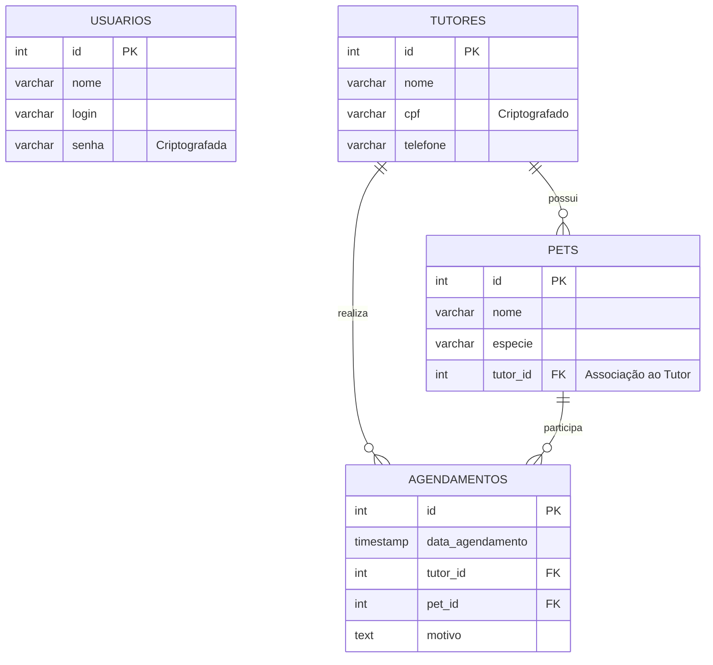

# VetSys - Sistema de Gestão para Clínica Veterinária

O **VetSys** é uma aplicação web desenvolvida em PHP com banco de dados PostgreSQL, criada para resolver as dificuldades de rotina de uma clínica veterinária. O sistema substitui o controle manual de agendamentos, tutores e pets por uma plataforma digital segura e eficiente. 

Com foco na proteção de dados e no cumprimento da LGPD, o sistema implementa criptografia de dados sensíveis (como o CPF dos tutores e senhas de acesso) e oferece módulos completos para gerenciar os cadastros e as consultas da clínica, evitando perda de horários e duplicidade de informações.

---

## Como Executar o Projeto Localmente

Para rodar este projeto na sua máquina, será necessário ter instalado um ambiente de servidor local (**PHP**) e o banco de dados **PostgreSQL**.

### Pré-Requisitos 
* **PHP** (v7.4 ou superior) habilitado com a extensão `pdo_pgsql`.
* **PostgreSQL** instalado e a rodar na porta `5432`padrão).
* **Git** instalado na máquina.

### Passo 1: Clonar e Configurar o Banco de Dados

O projeto inclui um script SQL completo (`script_vetsys.sql`) que já contém a criação das tabelas com chaves estrangeiras e a inserção de três registros iniciais para cada tabela, conforme exigência do projeto.

Abra o terminal e execute:
```bash
# Clone este repositório
git clone https://github.com/inumaki-david/saep/tree/main/prova042026

```

Acesse o terminal do PostgreSQL:
```bash
# Digite este comando no terminal
psql -U postgres

# Crie o banco de dados e conecte-se a ele
DROP DATABASE IF EXISTS vetsys_db;
CREATE DATABASE vetsys_db;
\c vetsys_db

# Execute o script de criação e população do banco
psql -U postgres -d vetsys_db -f script_vetsys.sql
```

### Passo 2: Configurar a Conexão no PHP

Na raiz do projeto, abra o arquivo conexao.php e ajuste as credenciais do PostgreSQL.

```php
$host = 'localhost';$dbname = 'vetsys_db';
$user = 'postgres';$password = 'postgres';
```

### Passo 3: Iniciar a Aplicação

Inicie o servidor embutido do PHP na raiz do projeto.
```bash
php -S localhost:8000
```

Acesse http://localhost:8000 no seu navegador. 
Utilize as credenciais cadastradas no banco (user: `admin` / senha: `123456`) para a validação de login.

---

## Especificação de Requisitos de Software
Especificação dos Requisistos de Software (SRE)  
Estrutura Baseada na ISO/IEC/IEEE 29148:2018

## 1. Introdução

#### 1.1 Escopo do Sistema
O escopo do sistema abrange a informatização do atendimento da clínica veterinária. Ele gerenciará a autenticação segura de usuários, o cadastro de tutores (com proteção de dados sensíveis), o registro de pets associados aos seus donos e o controle de agendamentos ordenados cronologicamente.

#### 1.2 Propósito
Garantir a organização dos processos de atendimento, eliminar a perda de consultas por falha humana e adequar o armazenamento de informações às normas da Lei Geral de Proteção de Dados (LGPD), assegurando a privacidade dos clientes.

---

## 2. Requisitos do Sistema 

### 2.1 Requisitos Funcionais

---
| ID | Título | Descrição |
| :--- | :--- | :--- | 
| **RF01** | Autenticação com Validação | O sistema deve possuir tela de login, validando credenciais no banco e exibindo mensagem de erro (frontend ou backend) em caso de falha. Após o sucesso, o usuário é redirecionado ao módulo principal. |
| **RF02** | Sessão de Usuário | O sistema deve criar uma sessão para o usuário autenticado com tempo de expiração configurado. | 
| **RF03** | Painel Principal | A tela principal deve recuperar e exibir o nome do usuário logado, fornecer um meio seguro de sair do sistema (logout) e links de acesso para as áreas de "Tutor", "Pet" e "Agendamento". |
| **RF04** | Gestão de Tutores (CRUD) | O sistema deve permitir listar, inserir, editar e excluir tutores. | 
| **RF05** | Busca de Tutores | A área de tutores deve conter um campo de busca que, ao inserir um termo e confirmar, atualiza a listagem da tabela apenas com os registros correspondentes. |
| **RF06** | Gestão de Pets | O sistema deve permitir o cadastro de novos pets, sendo obrigatório associá-los a um tutor previamente cadastrado no banco de dados. | 
| **RF07** | Listagem de Agendamentos | A tela de agendamentos deve listar as consultas cadastradas ordenadas por data, trazendo todos os dados do tutor e do pet envolvidos. |
| **RF08** | Atualização de Consultas | O sistema deve permitir alterar especificamente a data de um agendamento já cadastrado e salvar a edição no banco de dados. | 


### 2.2 Requisitos Não Funcionais

---
| ID | Título | Descrição | 
| :--- | :--- | :--- | 
| **RNF01** | Infraestrutura | O sistema deve ser codificado na linguagem PHP e utilizar o SGBD PostgreSQL. |
| **RNF02** | Segurança e LGPD | O sistema deve utilizar métodos de criptografia (como password_hash e funções de criptografia simétrica/hash) para armazenar a senha de acesso e o CPF dos tutores no banco de dados. |
---

### 3.3 Regras de Negócio

#### Módulo de Controle de Acervo e Membros 
| ID | Regra / Condição de Execução |
| :--- | :--- | 
| **RN01** | O banco de dados inicial deve conter obrigatoriamente três registros simulados para cada tabela do sistema. | 
| **RN02** | Um pet não pode existir no sistema sem estar vinculado à chave primária de um tutor válido. | 
| **RN03** | Se a sessão do usuário expirar por inatividade, ele deve ser redirecionado para a tela de login exigindo nova autenticação. | 
| **RN04** | Todos os relacionamentos no banco de dados devem garantir a integridade referencial através de chaves estrangeiras (Foreign Keys). | 

---

## 3. Estruturação do Banco de Dados 
O sistema utiliza um banco de dados relacional composto por 4 tabelas principais. As relações garantem a integridade referencial exigida pelas Regras de Negócio.

#### ENTIDADE: *`usuarios`* 

| Campo | Tipo | Restrições | Descrição |
| :--- | :--- | :--- | :--- |
| *`id`* | SERIAL | PRIMARY KEY | Identificador único do funcionário/gestor. | 
| *`nome`* | VARCHAR(100) | NOT NULL | Nome do usuário (exibido na tela principal). |
| *`login`* | VARCHAR(100) | UNIQUE, NOT NULL | Nome de usuário para acesso. | 
| *`senha_hash`* | VARCHAR(255) | NOT NULL | Senha armazenada de forma criptografada. |
---
#### ENTIDADE: *`tutores`*

| Campo | Tipo | Restrições | Descrição |
| :--- | :--- | :--- | :--- |
| *`id`* | SERIAL | PRIMARY KEY | Identificador único do tutor. |
| *`nome`* | VARCHAR(100) | NOT NULL | Nome completo. |
| *`cpf`* | VARCHAR(14) | UNIQUE, NOT NULL | CPF do tutor armazenado de forma criptografada. |
| *`telefone`* | VARCHAR(20) | | Contato do tutor. |
---
#### ENTIDADE: *`pets`* 

| Campo | Tipo | Restrições | Descrição |
| :--- | :--- | :--- | :--- |
| *`id`* | SERIAL | PRIMARY KEY | Identificador único do pet. |
| *`nome`* | VARCHAR(100) | NOT NULL | Nome do animal. |
| *`especie`* | VARCHAR(50) | NOT NULL | Cão, Gato, Ave, etc. |
| *`tutor_id`* | INT | FOREIGN KEY | Associação obrigatória com o Tutor. |
---
#### ENTIDADE: *`agendamentos`* 

| Campo | Tipo | Restrições | Descrição |
| :--- | :--- | :--- | :--- |
| *`id`* | SERIAL | PRIMARY KEY | Identificador único do agendamento. |
| *`data_agendamento`* | TIMESTAMP | NOT NULL | Data e hora da consulta, usada para ordenação. |
| *`tutor_id`* | INT | FOREIGN KEY | Referência ao tutor. |
| *`pet_id`* | INT | FOREIGN KEY | Referência ao pet da consulta. |
| *`motivo`* | TEXT | | Descrição do atendimento. |

---

## 4. Diagramas 

###  5.1 Diagrama de Entidade-Relacionamento (DER)

O diagrama abaixo ilustra a estrutura das tabelas do banco de dados e os seus relacionamentos.


---
