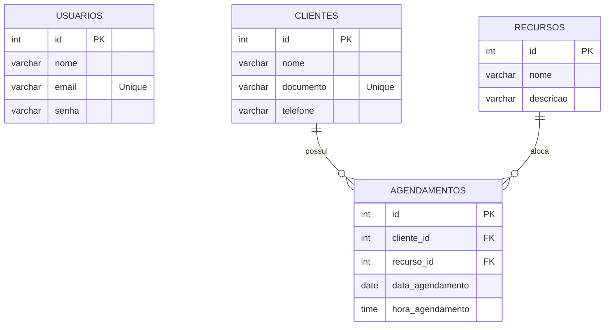
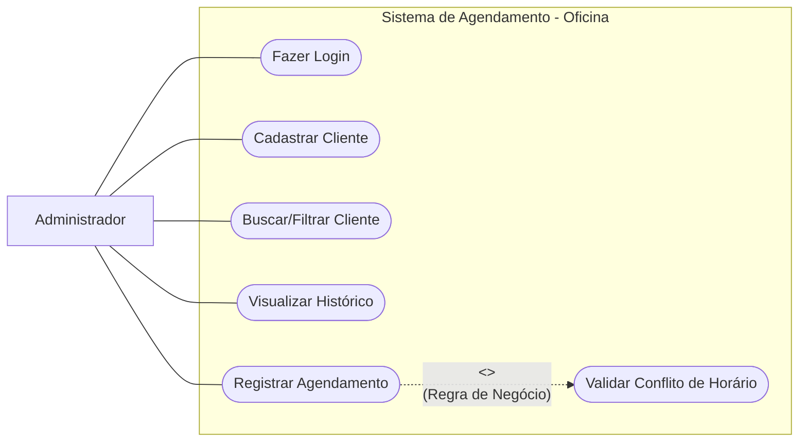
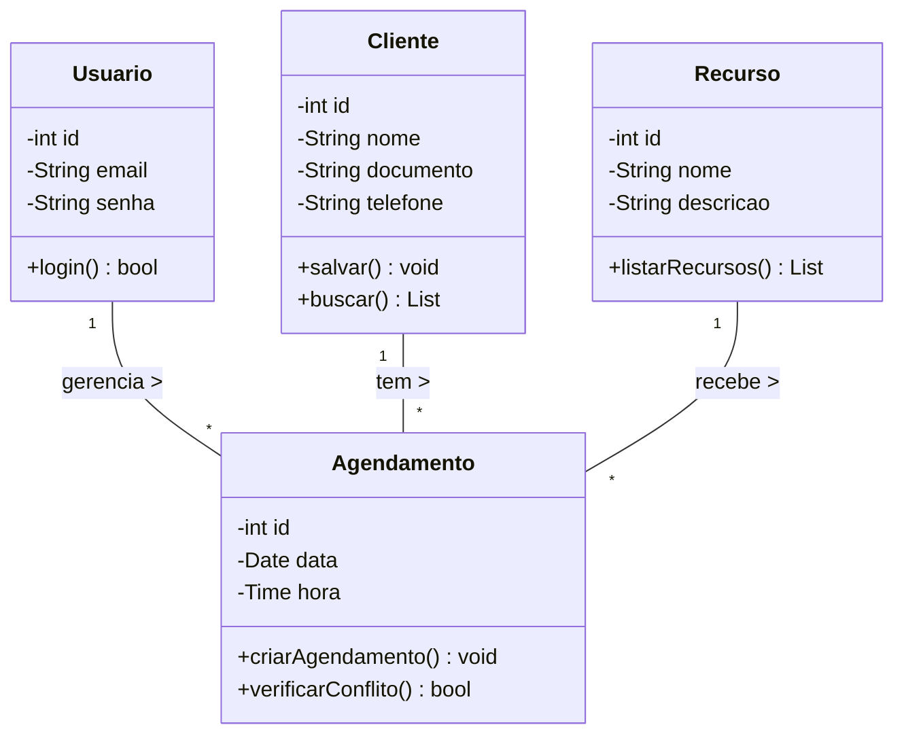
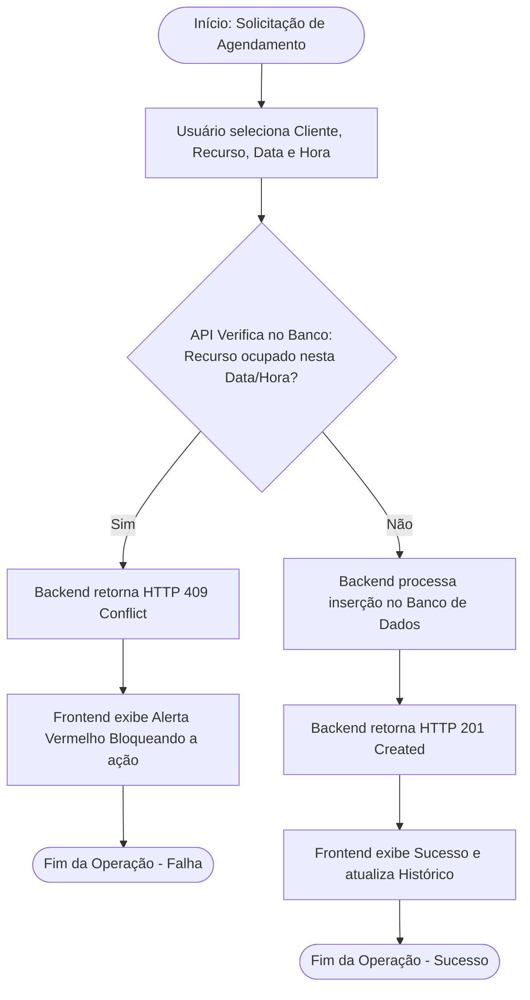

# SAEP - Sistema de Agendamento Inteligente para uma Oficina Mecânica

O **Sistema de Agendamento Inteligente** é uma aplicação web Fullstack desenvolvida como solução "White-Label" e adaptada para o nicho de **Oficinas Mecânicas Automotivas**. O sistema tem como objetivo principal digitalizar e organizar a gestão de horários, eliminando o uso de agendas de papel e planilhas confusas.

O grande diferencial e núcleo do sistema é a sua trava de segurança contra **double-booking** (sobreposição de horários). O sistema impede categoricamente que dois veículos sejam agendados para o mesmo recurso (Elevador ou Box de Serviço) na mesma data e hora, prevenindo prejuízos e atrasos na oficina.

---

## Como Executar o Projeto Localmente

O projeto é dividido em duas partes: o **Backend (API REST com Node.js)** e o **Frontend (SPA com Angular)**.

### Pré-Requisitos 
* **Node.js** (v18 ou superior) instalado.
* **Angular CLI** (v15 ou superior) instalado globalmente.
* **PostgreSQL** instalado e rodando na porta `5432` (padrão).
* **Git** instalado na máquina.

### Passo 1: Clonar o Repositório

Abra o terminal e execute:
```bash
# Clone este repositório
git clone [https://github.com/inumaki-david/saep/tree/main/provasaepteste2026]

# Acesse a pasta do projeto
cd provasaepteste2026
```

### Passo 2: Configurar o Banco de Dados

* Conecte-se ao seu PostgreSQL (via pgAdmin ou psql).

* Crie um banco de dados chamado saep_agendamento_db.

* Execute o arquivo script_banco.sql (localizado na pasta database do repositório) para criar as tabelas e popular os recursos (Elevadores/Boxes) e o usuário administrador inicial.

### Passo 3: Executar o Backend (API)

```bash
# Navegue até a pasta do backend
cd backend

# Instale as dependências
npm install

# Configure as variáveis de ambiente (.env) com as credenciais do seu banco PostgreSQL
# Exemplo: DB_USER=postgres, DB_PASS=suasenha, DB_NAME=saep_agendamento_db

# Inicie o servidor de desenvolvimento
npm run dev

```
A API estará rodando em http://localhost:3000.

### Passo 4: Executar o Frontend (Angular)

Abra um novo terminal e execute:
```bash
# Navegue até a pasta do frontend
cd frontend

# Instale as dependências
npm install

# Inicie a aplicação Angular
ng serve
```
O sistema estará acessível no navegador em: http://localhost:4200.

---

## Informações de Entrada (Administrador Padrão)

E-mail: `admin@oficina.com`

Senha: `admin123`

---

## Especificação de Requisitos de Software

Especificação dos Requisistos de Software (SRE)
Estrutura Baseada na ISO/IEC/IEEE 29148:2018

### 1. Introdução

#### 1.1 Escopo do Sistema

Este documento define os requisitos para a aplicação de Agendamento para Oficina Mecânica. O sistema visa gerenciar a carteira de clientes e o uso do espaço físico operacional (Elevadores e Boxes de Serviço) através de uma aplicação web.

A aplicação utilizará Node.js (Express) para a construção da API REST, Angular para a interface de usuário e PostgreSQL para persistência e validação de dados.

#### 1.2 Propósito

O propósito é fornecer uma ferramenta para o administrador/gerente da oficina realizar o agendamento de serviços, garantindo através de regras de negócio estritas no backend que nenhum elevador mecânico receba mais de um agendamento simultâneo, otimizando o fluxo de trabalho da oficina.

### 2. Descrição Global

#### 2.1 Funções do Sistema

* Realizar login no sistema (Autenticação do administrador).

* Cadastrar, listar, editar e excluir clientes (CRUD).

* Buscar clientes por nome ou documento (Filtro).

* Visualizar recursos operacionais disponíveis (Elevadores e Boxes).

* Registrar novos agendamentos vinculando Cliente, Recurso, Data e Hora.

* Validar e bloquear tentativas de agendamentos no mesmo recurso e horário.

* Visualizar o histórico completo de agendamentos realizados.

#### 2.2 Características dos Usuários

| Usuário | Descrição |
| :--- | :--- | 
| **Administrador** | Usuário único do sistema. Possui acesso total à plataforma, sendo responsável pelo cadastro de clientes e pelo controle/inserção dos agendamentos na oficina. |

---

## 3. Requisitos do Sistema 

### 3.1 Requisitos Funcionais

#### Módulo de Autenticação
| ID | Título | Descrição | Prioridade |
| :--- | :--- | :--- | :--- |
| **RF01** | Autenticação | O sistema deve possuir uma tela de login validando e-mail e senha. Em caso de falha, deve exibir o motivo." | Alta |
---
#### Módulo de Gestão de Clientes
| ID | Título | Descrição | Prioridade |
| :--- | :--- | :--- | :--- |
| **RF02** | CRUD de Clientes | O sistema deve listar clientes em uma grid e permitir cadastro, edição e exclusão. | Alta |
| **RF03** | Validação Visual | O formulário de clientes deve possuir validação visual de campos obrigatórios no frontend. | Alta |
| **RF04** | Filtro de Busca | A lista de clientes deve possuir um campo de busca para filtrar registros por nome ou documento. | Média |
---
#### Módulo de Agendamentos
| ID | Título | Descrição | Prioridade |
| :--- | :--- | :--- | :--- |
| **RF05** | Realizar Agendamento | O formulário deve permitir selecionar um Cliente, Data, Hora e um Recurso (povoado dinamicamente do banco). | Alta |
| **RF06** | Histórico de Agendamentos | O sistema deve listar todos os agendamentos já realizados, exibindo data, hora, cliente e recurso. | Alta |

---

### 3.2 Requisitos Não Funcionais

| ID | Título | Descrição | Prioridade |
| :--- | :--- | :--- | :--- |
| **RNF01** | Arquitetura | O sistema deve ser separado em Frontend (Angular) e Backend (Node.js API REST). | Alta | 
| **RNF02** | Banco de Dados | O armazenamento e as consultas de validação de horários devem ser processadas no PostgreSQL. | Alta |
| **RNF03** | Interface | O layout deve exibir o nome do usuário logado, botão de logout e navegação clara entre as telas. | Alta | 

---

### 3.3 Regras de Negócio

| ID | Título | Regra / Condição de Execução |
| :--- | :--- | :--- |
| **RN01** | Prevenção de Choque de Horário | Ao tentar salvar um agendamento, se o "Recurso" já possuir um registro para a mesma Data e Hora, a API deve retornar erro (HTTP 409) e o Angular deve exibir um alerta bloqueando a ação. | 
| **RN02** | Integridade Referencial | Um recurso ou cliente não pode ser deletado caso isso corrompa o histórico de agendamentos (utilizar restrições de chave estrangeira adequadas, como CASCADE ou RESTRICT). | 

---

## 4. Estruturação do Banco de Dados 

O sistema utiliza um banco de dados relacional composto por 4 tabelas principais. As relações garantem a integridade referencial exigida pelas Regras de Negócio.

#### ENTIDADE: *`usuarios`* 
| Campo | Tipo | Restrições | Descrição |
| :--- | :--- | :--- | :--- |
| *`id`* | SERIAL | PRIMARY KEY | Identificador único. |
| *`nome`* | VARCHAR(100) | NOT NULL | Nome do Administrador. |
| *`email`* | VARCHAR(100) | UNIQUE, NOT NULL | E-mail para acesso. |
| *`senha`* | VARCHAR(255) | NOT NULL | Credencial de acesso. |
---
#### ENTIDADE: *`clientes`* 
| Campo | Tipo | Restrições | Descrição |
| :--- | :--- | :--- | :--- |
| *`id`* | SERIAL | PRIMARY KEY | Identificador único do cliente. |
| *`nome`* | VARCHAR(100) | NOT NULL | Nome do proprietário do veículo. |
| *`documento`* | VARCHAR(20) | UNIQUE, NOT NULL | CPF ou CNH do cliente. |
| *`telefone`* | VARCHAR(20) | NOT NULL | Contato do cliente. |
---
#### ENTIDADE: *`recursos`* 
| Campo | Tipo | Restrições | Descrição |
| :--- | :--- | :--- | :--- |
| *`id`* | SERIAL | PRIMARY KEY | Identificador único do Elevador/Box. |
| *`nome`* | VARCHAR(100) | NOT NULL | Nome do recurso (Ex: Elevador 1). |
| *`descricao`* | VARCHAR(255) |  | Detalhes da capacidade ou uso. |
---
#### ENTIDADE: *`agendamentos`* 
| Campo | Tipo | Restrições | Descrição |
| :--- | :--- | :--- | :--- |
| *`id`* | SERIAL | PRIMARY KEY | Número único do agendamento. |
| *`cliente_id`* | INT | FOREIGN KEY | Id de referência ao cliente. |
| *`recurso_id`* | INT | FOREIGN KEY | Id de referência ao elevador/box. |
| *`data_agendamento`* | DATE | NOT NULL | Data do serviço. |
| *`hora_agendamento`* | TIME | NOT NULL | Horário de entrada do veículo. |
| *`hora_saida_agendamento`* | TIME | NOT NULL | Horário de saída do veículo. |

---

## 5. Diagramas

### 5.1 Diagrama de Entidade-Relacionamento (MER)

O diagrama abaixo ilustra a estrutura das tabelas do banco de dados e os seus relacionamentos.



---

### 5.2 Diagrama de Casos de Uso

O diagrama abaixo ilustra as principais funcionalidades do Sistema de Agendamento e seus casos de uso.



---

### 5.3 Diagrama de Classes (Abstração do Sistema)

O diagrama de classes abaixo ilustra a estrutura das entidades do sistema, os seus atributos (variáveis) e os seus métodos principais (funções).



---

### 5.4 Diagrama de Fluxo (Lógica de Prevenção de Conflito)



---

